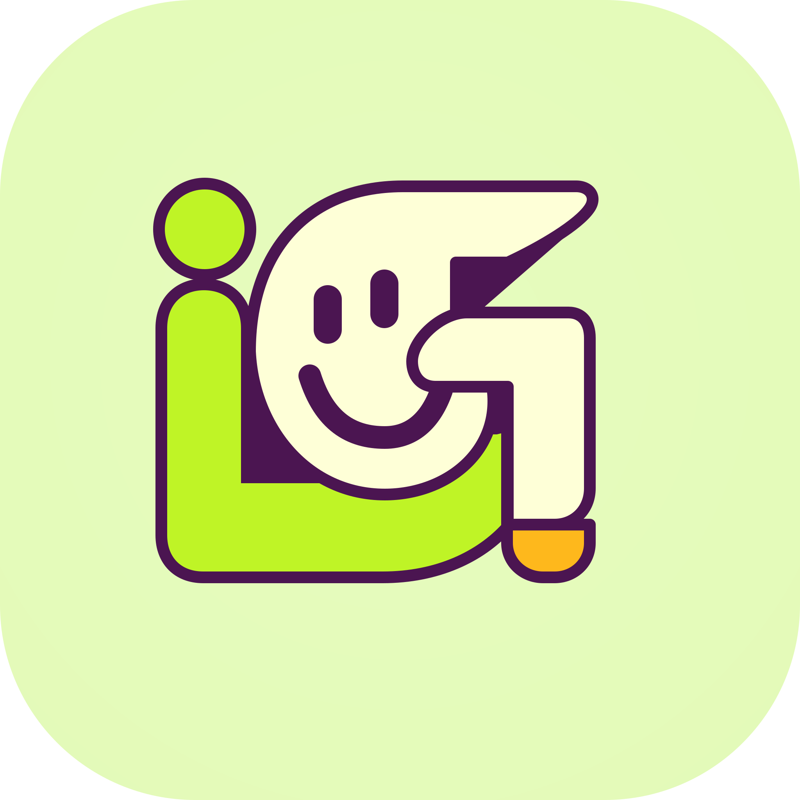

<div>
  
</div>

# iGood Studio Official Website>

> iGood Studio liquid glass style landing page, built with Tailwind CSS.

> English | [简体中文](README.zh-Hans.md) | [繁體中文](README.zh-Hant.md)

## ✨ Features
- Apple-style liquid frosted glass interface
- Fully responsive layout, adaptable to both mobile and desktop
- Mobile hamburger navigation menu
- Smooth page scrolling
- 100% Static, no build tools required
- MIT License

## 🛠 Tech Stack
- HTML5
- Tailwind CSS
- Vanilla JavaScript
- Inter Font

## 📦 Quick Start

1. **Clone the repository:**
```bash
git clone https://github.com/iGoods-CN/igood-studio-site.git
cd igood-studio-site
```

2. **Replace image assets (Important):**
- `example.png`: Website Logo, favicon, and banner image. You can replace it with your custom images by keeping the filename unchanged, or modify the reference path in the HTML.
- `example_icon.png`: Small icons used in the navigation bar buttons. Just replace it with your own icon files.

3. **Run locally:**
Open `index.html` directly in your browser. No build tools or additional dependencies are required.

## 📄 License & Version Notice

### V1.0 (Current Version)
This project V1.0 is open-sourced under the **MIT License**. Please see the [LICENSE](./LICENSE) file for the full license text.

> **⚠️ Version Plan Statement**:
> V1.0 will be permanently archived as a historical version and will remain open-source strictly under the MIT License.
> The development team reserves the right to make **V2.0 and subsequent future versions** closed-source, proprietary, or commercially licensed. Thank you for your attention and support for V1.0!

**Trademark Notice:**
The MIT License covers the source code only. It does **not** grant any rights to use the "iGood Studio" or "iGoods" brand names, logos, or trademarks. If you use this template, you must remove all brand-related elements and links. You may not use this project to imply official endorsement.

## 🔗 Links

- Demo Site:[https://www.igoodz.top/old-index](https://www.igoodz.top/old-index)
- GitHub：[https://github.com/igoodz-top/iGoods--Offical_Website](https://github.com/igoodz-top/iGoods--Offical_Website)

---

## 📷 Image Replacement Guide

### 1. **example.png**
- **Usage**: favicon, apple-touch-icon, navigation Logo, homepage Banner image
- **Recommended Dimensions**:
  - Logo: 512×512px square PNG with transparent background
  - Banner: 1920×800px

### 2. **example_icon.png**
- **Usage**: Small icons inside navigation bar buttons (prefix icons for GitHub, Email, etc.)
- **Recommended Dimensions**: 24×24px, transparent PNG

### 3. Replacement Methods
- **Method 1 (Easiest)**: Simply rename your images and overwrite `example.png` / `example_icon.png`. No code modification is needed.
- **Method 2 (Custom)**: Keep the original filenames, and modify the `src="xxx"` paths in the HTML to point to your new image paths.
```
