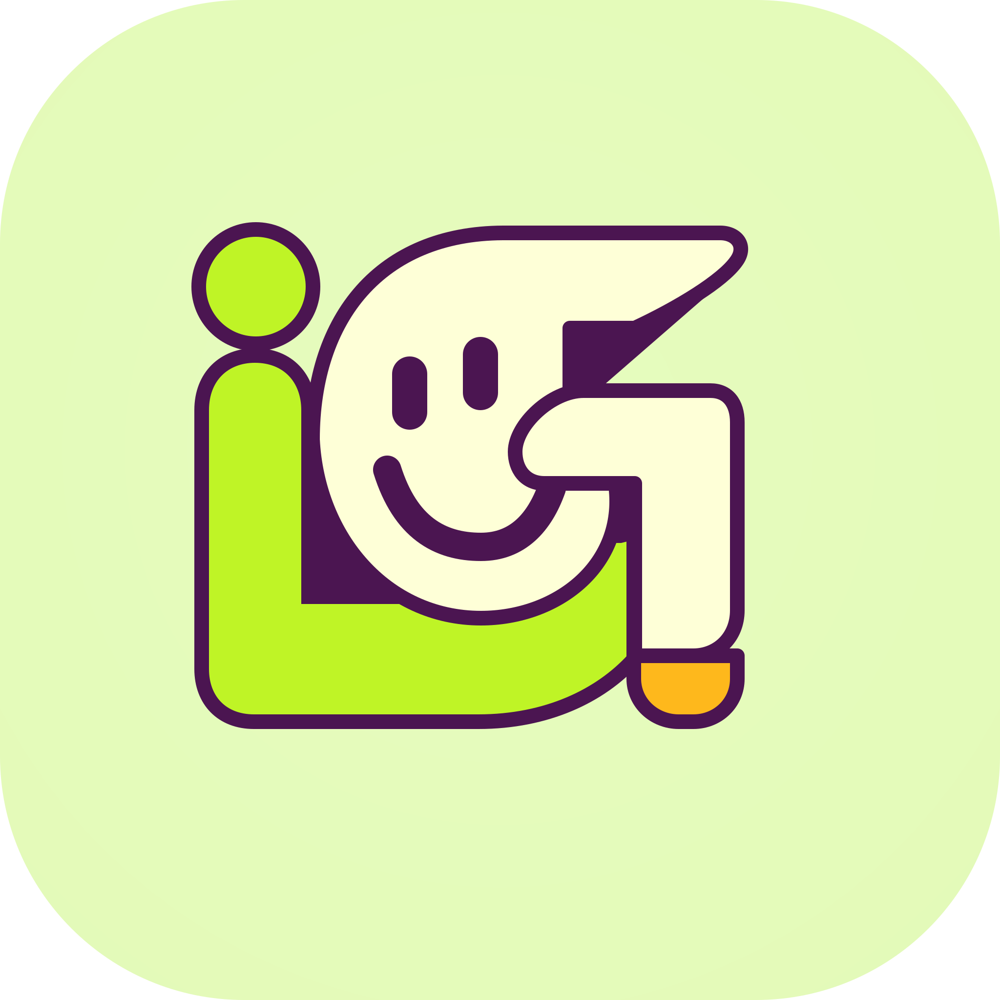

<div>
  
</div>

# iGood Studio 官方網站
> iGood Studio 液態玻璃風格落地頁，使用 Tailwind CSS 建置。

> [English](README.md) | [简体中文](README.zh-Hans.md) | 繁體中文

## ✨ 功能特色
- Apple 風格液態磨砂玻璃介面
- 完全響應式版面，適配手機與桌面裝置
- 行動版漢堡導覽選單
- 平滑頁面捲動
- MIT License

## 🛠 技術棧
- HTML5
- Tailwind CSS
- 原生 JavaScript
- Inter Font

## 📦 快速開始

1. 複製儲存庫
```bash
git clone https://github.com/iGoods-CN/igood-studio-site.git
cd igood-studio-site
```

2. 替換圖片資源（**重要**）

- `example.png`：網站 Logo、favicon、橫幅圖片。你可以保持檔名不變，直接替換為自訂圖片；或修改 HTML 中的引用路徑。
- `example_icon.png`：導覽列按鈕中使用的小圖示。只需替換為你自己的圖示檔案。

3. 直接在瀏覽器中開啟 `index.html`
無需建置工具或額外相依套件。

## 📄 授權與版本聲明

### V1.0（目前版本）
本專案 V1.0 以 **MIT License** 開源。完整授權條款請參閱 [LICENSE](./LICENSE) 檔案。

> **⚠️ 版本規劃聲明**：
> V1.0 將永久封存為歷史版本，並嚴格依 MIT License 保持開源。
> 開發團隊保留將 **V2.0 及後續未來版本** 改為閉源、專有或商業授權的權利。感謝你對 V1.0 的關注與支持！

## 🔗 連結

- 示範網站：[https://cn.igoods.cc.cd/](https://cn.igoods.cc.cd/)
- GitHub：[https://github.com/iGoods-CN](https://github.com/iGoods-CN)

---

## 📷 圖片替換指南（補充）

### 1. **example.png**
- **用途**：favicon、apple-touch-icon、導覽列 Logo、首頁橫幅圖片
- **建議尺寸**：
  - Logo：512×512px 正方形 PNG，透明背景
  - 橫幅：1920×800px

### 2. **example_icon.png**
- **用途**：導覽列按鈕內的小圖示（Github、Email 等前綴圖示）
- **建議尺寸**：24×24px，透明 PNG

### 3. 兩種替換方式
- **方法一（最簡單）**：將圖片重新命名並覆蓋 `example.png` / `example_icon.png`。無需修改程式碼。
- **方法二（自訂）**：保留原始檔名，並修改 HTML 中的 `src="xxx"` 路徑，指向新的圖片路徑。
