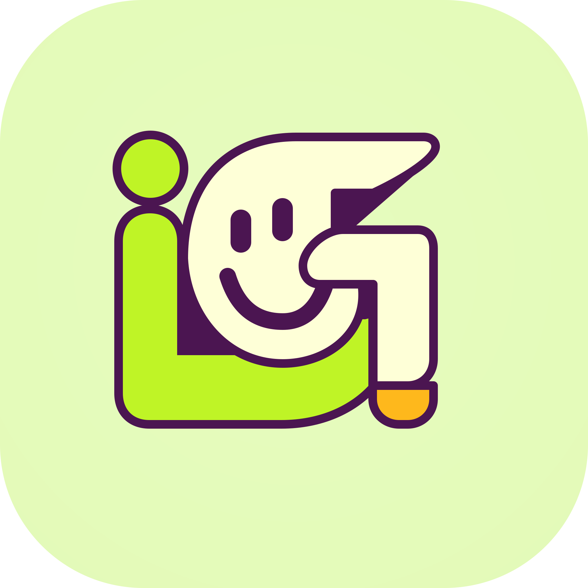

<div align="center">
  
</div>

# iGood Studio 官方网站
> iGood Studio 液态玻璃风格落地页，使用 Tailwind CSS 构建。

> [English](./README.md) | 简体中文

## ✨ 功能特性
- 苹果风液态毛玻璃界面
- 完整响应式布局，适配移动端与桌面端
- 移动端汉堡导航菜单
- 页面平滑滚动
- MIT 开源协议

## 🛠 技术栈
- HTML5
- Tailwind CSS
- 原生 JavaScript
- Inter 字体

## 📦 快速开始

1. 克隆仓库
```bash
git clone https://github.com/iGoods-CN/igood-studio-site.git
cd igood-studio-site
```

2. 替换图片资源（**重要**）

- `example.png`：网站 Logo、网页图标、横幅大图。可替换为自定义图片，保持文件名不变，或者修改 HTML 内引用路径。
- `example_icon.png`：导航栏按钮内使用的小图标。替换为你自己的图标文件即可。

3. 使用浏览器直接打开 `index.html`
无需构建工具与额外依赖。

## 📄 开源协议与版本说明

### V1.0 (当前版本)
本项目 V1.0 基于 **MIT 协议**开源。完整协议内容请查看 [LICENSE](./LICENSE) 文件。

> **⚠️ 版本计划声明**：
> V1.0 将作为历史版本永久归档，并严格按照 MIT 协议保持开源。
> 开发团队保留对 **V2.0 及后续未来版本**采取闭源、私有化或商业授权模式的权利。感谢您对 V1.0 的关注与支持！

## 🔗 相关链接

- 演示站点：[https://cn.igoods.cc.cd/](https://cn.igoods.cc.cd/)
- GitHub：[https://github.com/iGoods-CN](https://github.com/iGoods-CN)

---

## 📷 图片替换说明（补充）

### 1. **example.png**
- **用途**：favicon、apple-touch-icon、导航 Logo、首页 Banner 大图
- **推荐尺寸**：
  - Logo：512×512px 正方形 PNG 透明底
  - Banner：1920×800px

### 2. **example_icon.png**
- **用途**：导航栏按钮内小图标（Github、邮件等前置图标）
- **推荐尺寸**：24×24px，透明 PNG

### 3. 两种替换方式
- **方式1（最简单）**：直接把你的图片重命名，覆盖 `example.png` / `example_icon.png` 即可，无需修改任何代码。
- **方式2（自定义）**：保留原文件名，修改 HTML 里 `src="xxx"` 路径，指向你新建的图片路径。